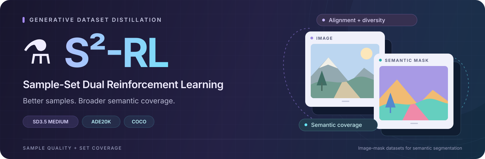

<p align="center">
  
</p>

<h1 align="center">⚗️ S²-RL</h1>

<p align="center">
  <strong>Sample-Set Dual Reinforcement Learning<br>for Generative Semantic Segmentation Dataset Distillation</strong>
</p>

<p align="center">
  <a href="https://haoyuwang.com">Haoyu Wang</a> · <a href="https://scholar.google.com/citations?hl=en&amp;user=Sd2wRM4AAAAJ">Fei Zhou</a> · <a href="https://openreview.net/profile?id=~Qingqing_Qiu1">Qingqing Qiu</a> · <a href="https://teacher.nwpu.edu.cn/nwpuzhanglei.html">Lei Zhang</a> · <a href="https://teacher.nwpu.edu.cn/weiwei.html">Wei Wei</a> · <a href="https://gr.xupt.edu.cn/info/1213/7446.htm">Chen Ding</a>
</p>

<p align="center">
  <a href="https://00why00.github.io/S2RL/"></a>
  <a href="https://arxiv.org/abs/2610.35491"></a>
  <a href="#training"></a>
  <a href="https://huggingface.co/0why0/S2RL"></a>
  <a href="LICENSE"></a>
</p>

<p align="center">
  <a href="#overview">Overview</a> ·
  <a href="#installation">Installation</a> ·
  <a href="#data">Data</a> ·
  <a href="#training">Training</a> ·
  <a href="#evaluation">Evaluation</a> ·
  <a href="#citation">Citation</a>
</p>

---

<a id="overview"></a>

## 📖 Overview

S²-RL adapts Stable Diffusion 3.5 Medium with sample-level semantic alignment and feature diversity rewards, together with a set-level semantic coverage reward. It constructs compact image–mask datasets for downstream segmentation training.

This repository provides the S²-RL implementation for **ADE20K and COCO**.

```text
.
├── train_sd3_set.py
├── config/
│   ├── base_sd3.py
│   ├── grpo_sd3.py
│   └── mmseg/{ade20k,coco}.py
├── dataset/
│   ├── ade20k.py
│   └── coco.py
├── rewards/calculate.py
├── pipelines/ema.py
├── scripts/
│   ├── prepare/{ade20k,coco}.sh
│   ├── train/{ade20k,coco}.sh
│   ├── gen/{ade20k,coco}.sh
│   └── mmseg/{ade20k,coco}.sh
└── utils/                           # Feature extraction, KMeans, generation, results
```

<a id="installation"></a>

## 🛠️ Installation

```bash
conda create -n s2rl python=3.10 -y
conda activate s2rl
python -m pip install torch==2.8.0 torchvision==0.23.0 --index-url https://download.pytorch.org/whl/cu128
python -m pip install -r requirements.txt
```

Configure Hugging Face model access and SwanLab logging before training.

Run commands from the repository root with the following paths:

```bash
export S2RL_DATA_ROOT=/absolute/path/to/dataset
export S2RL_FEATS_ROOT=/absolute/path/to/S2RL/feats
export MMSEG_ROOT=/absolute/path/to/third-party/mmsegmentation-main
```

Set the paths and names at the top of the corresponding scripts.

<a id="data"></a>

## 📂 Data & Prototypes

```text
$S2RL_DATA_ROOT/
├── ADE20K/
│   ├── images/{training,validation}/
│   ├── annotations/{training,validation}/
│   └── ADE20K_train.txt
├── COCO/
│   ├── train2017/
│   ├── val2017/
│   └── annotations/panoptic_semantic_{train2017,val2017}/
└── ILDistillation/
    ├── ADE20K/uniform/{images,annotations}/time_<n>_ratio_<r>/
    └── COCO/uniform/{images,annotations}/time_<n>_ratio_<r>/
```

`ADE20K_train.txt` lists absolute paths to training images, one per line. ADE20K labels use `1..150`, with `0` ignored.

COCO semantic masks are single-channel PNGs with the same basenames as their images. Labels use `0..132` in the order defined by `COCO_dict` in [dataset/coco.py](dataset/coco.py); `255` is ignored.

### Selected real-data subsets

The selection baselines provide subsets of real images and their ground-truth masks.

| Method | ADE20K | COCO |
| :--- | :---: | :---: |
| Random | [Download](https://huggingface.co/0why0/S2RL/resolve/main/datasets/ADE20K/Random.tar.gz?download=true) | [Download](https://huggingface.co/0why0/S2RL/resolve/main/datasets/COCO/Random.tar.gz?download=true) |
| Uniform | [Download](https://huggingface.co/0why0/S2RL/resolve/main/datasets/ADE20K/Uniform.tar.gz?download=true) | [Download](https://huggingface.co/0why0/S2RL/resolve/main/datasets/COCO/Uniform.tar.gz?download=true) |
| Herding | [Download](https://huggingface.co/0why0/S2RL/resolve/main/datasets/ADE20K/Herding.tar.gz?download=true) | [Download](https://huggingface.co/0why0/S2RL/resolve/main/datasets/COCO/Herding.tar.gz?download=true) |
| K-Center | [Download](https://huggingface.co/0why0/S2RL/resolve/main/datasets/ADE20K/K-Center.tar.gz?download=true) | [Download](https://huggingface.co/0why0/S2RL/resolve/main/datasets/COCO/K-Center.tar.gz?download=true) |

All data archives include three ratios and five sets per ratio. Extract archives into `$S2RL_DATA_ROOT` to retain the `ILDistillation/...` layout.

S²-RL uses the preselected **Uniform** subsets to construct category prompts, with five subsets (`n = 1..5`) per ratio. Preserve the original filenames and image–mask pairs in the layout above.

| Dataset | Ratios |
| :--- | :--- |
| ADE20K | `0.0025`, `0.005`, `0.01` |
| COCO | `0.000625`, `0.00125`, `0.0025` |

### Prototype construction

DINOv3 region features are extracted from the full training split and clustered with Euclidean KMeans. Each class has up to 50 observed representatives, selected by maximum cosine similarity to the cluster centers.

```bash
bash scripts/prepare/ade20k.sh
bash scripts/prepare/coco.sh
```

<a id="training"></a>

## 🚀 Policy Training & Generation

### 1. Policy training

```bash
bash scripts/train/ade20k.sh
bash scripts/train/coco.sh
```

One policy is trained per dataset using the union of its three Uniform budgets.

| Dataset | Policy weights | Adapter config |
| :--- | :---: | :---: |
| ADE20K | [Download](https://huggingface.co/0why0/S2RL/resolve/main/checkpoints/ADE20K/adapter_model.safetensors?download=true) | [Download](https://huggingface.co/0why0/S2RL/resolve/main/checkpoints/ADE20K/adapter_config.json?download=true) |
| COCO | [Download](https://huggingface.co/0why0/S2RL/resolve/main/checkpoints/COCO/adapter_model.safetensors?download=true) | [Download](https://huggingface.co/0why0/S2RL/resolve/main/checkpoints/COCO/adapter_config.json?download=true) |

Save both files in the same directory.

### 2. Generation and selection

Set `POLICY_DIR` to the adapter directory and `DATASET_NAME` to the output dataset name:

```bash
bash scripts/gen/ade20k.sh
bash scripts/gen/coco.sh
```

Selected images are saved to `$S2RL_DATA_ROOT/ILDistillation/<dataset>/<DATASET_NAME>/images/time_<n>_ratio_<r>/`.

Run generation jobs sequentially when they share the same dataset directory.

#### Distilled datasets

S²-RL provides distilled datasets of generated images and pseudo-labels for downstream segmentation training.

| Method | ADE20K | COCO |
| :--- | :---: | :---: |
| **S²-RL** | [Download](https://huggingface.co/0why0/S2RL/resolve/main/datasets/ADE20K/S2RL.tar.gz?download=true) | [Download](https://huggingface.co/0why0/S2RL/resolve/main/datasets/COCO/S2RL.tar.gz?download=true) |

Extract into `$S2RL_DATA_ROOT`. Image–mask pairs are stored under `ILDistillation/<dataset>/S2RL/`.

<a id="evaluation"></a>

## 🏋️ Downstream Evaluation

Train **SegFormer-B5** on the released image–mask pairs with [MMSegmentation](https://github.com/open-mmlab/mmsegmentation), then evaluate **mIoU and mAcc on the real validation split**.

| Dataset | MMSeg config |
| :--- | :--- |
| ADE20K | [SegFormer-B5](config/mmseg/ade20k.py) |
| COCO | [SegFormer-B5](config/mmseg/coco.py) |

In the MMSegmentation environment, use `DATASET_NAME="S2RL"` for the released datasets and run:

```bash
bash scripts/mmseg/ade20k.sh
bash scripts/mmseg/coco.sh
```

## 🤝 Acknowledgements

This implementation builds on [Flow-GRPO](https://github.com/yifan123/flow_grpo), [GRPO-Guard](https://github.com/hxm2023/GRPO-Guard), [DDPO](https://github.com/kvablack/ddpo-pytorch), [Diffusers](https://github.com/huggingface/diffusers), and [MMSegmentation](https://github.com/open-mmlab/mmsegmentation).

<a id="citation"></a>

## 🖊️ Citation

```bibtex
@misc{wang2026s2rl,
  title={S$^2$-RL: Sample-Set Dual Reinforcement Learning for Generative Semantic Segmentation Dataset Distillation},
  author={Haoyu Wang and Fei Zhou and Qingqing Qiu and Lei Zhang and Wei Wei and Chen Ding},
  year={2026},
  eprint={2610.35491},
  archivePrefix={arXiv},
  primaryClass={cs.CV},
  url={https://arxiv.org/abs/2610.35491}
}
```

## 📄 License

S²-RL contributions are licensed under the [MIT License](LICENSE). Third-party components and assets follow their original licenses.
